# Project 3: Active Directory & DNS Environment

For this project, I built a small Windows domain on my own PC using Hyper-V to learn the fundamentals of Active Directory and DNS, and how companies use them to manage users and computers.

## Lab Setup

| Component | Details |
|---|---|
| Hypervisor | Hyper-V |
| Domain Controller | `DC01` — Windows Server 2025 (192.168.1.5) |
| Client | `WIN11-01` — Windows 11 Pro (192.168.1.101) |
| Domain | `kojo.lab` |
| Network | Private virtual switch, separate from my home network |

  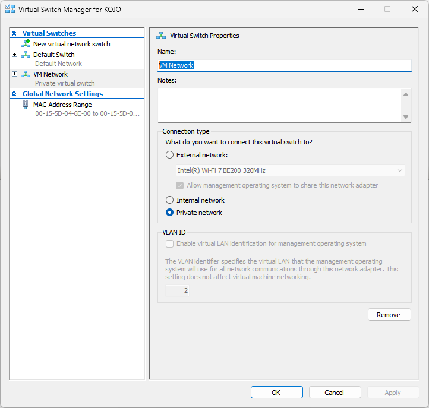

  <em>Private virtual switch used to keep the lab separate from my home network.</em>

## Setting Up the Domain

I gave the server a static IP, installed the Active Directory Domain Services and DNS roles, and promoted it to a domain controller for `kojo.lab`.

In a company, the domain controller is the central place where all user accounts and computers are managed. Instead of creating a separate account on every computer, IT creates one account in Active Directory, and the employee can use it to sign in to any computer on the domain. The domain controller checks the username and password each time someone signs in. That's also why it needs a static IP: every computer on the network needs to be able to find it at the same address.

  
  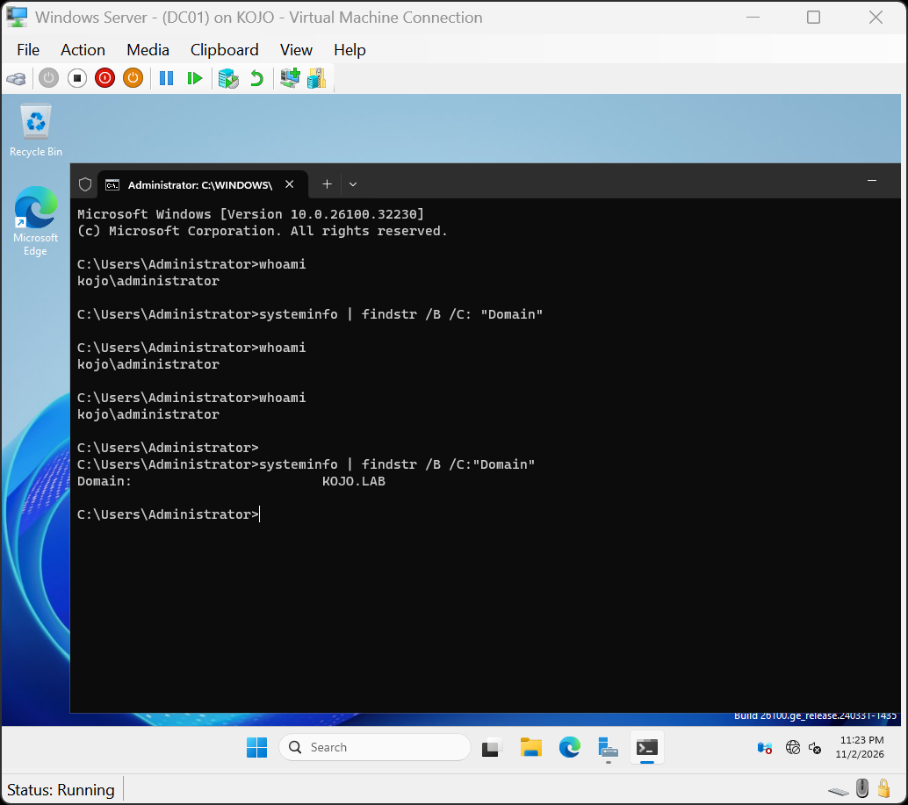

  <em>Server roles installed, and the domain confirmed with whoami and systeminfo.</em>

## Users, Groups, and OUs

I created Organizational Units (OUs) to organize accounts, then added users and security groups.

OUs work like folders. Companies use them to organize accounts, for example by department, which makes accounts easier to find and manage.

Groups are used to control access. Instead of giving permissions to each person one at a time, IT gives permissions to a group, like Managers, and adds people to it. When someone joins or leaves a team, IT just adds them to or removes them from the group.

  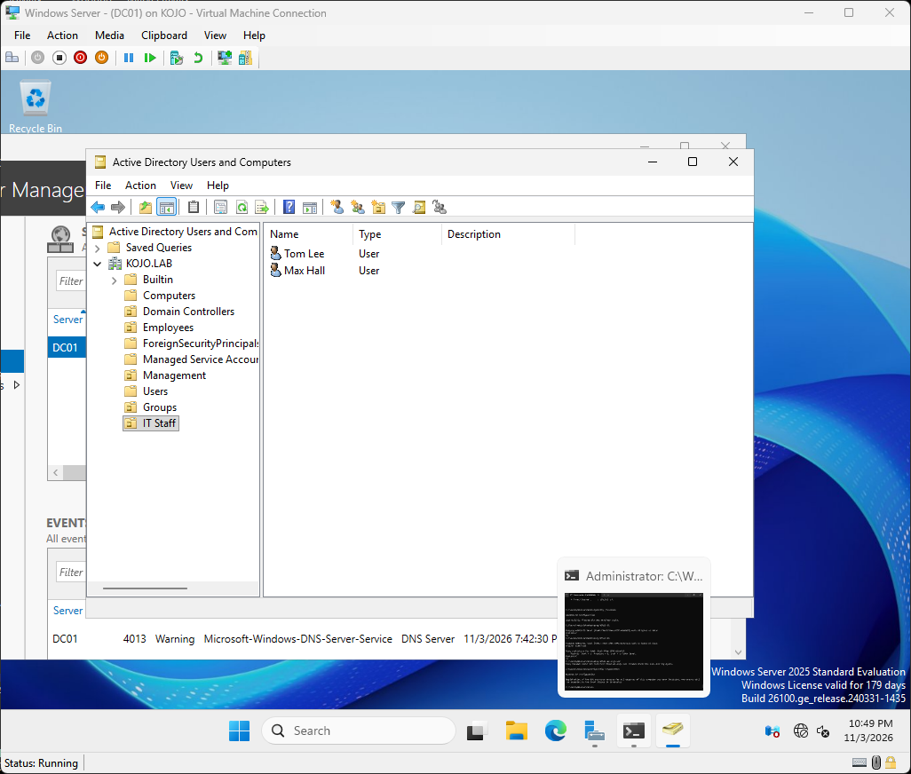
  

  <em>OU structure and a user's group membership in Active Directory.</em>

## DNS

DNS was set up along with the domain controller.

DNS turns names into IP addresses. When a computer wants to reach `kojo.lab`, it asks DNS for the IP address and then connects to it.

That's why domain computers need to use the domain controller for DNS. It's the DNS server that knows where `kojo.lab` is. The screenshot shows each computer's name matched to its IP address.

  

  <em>DNS forward lookup zone for kojo.lab.</em>

## Joining a Computer to the Domain

I pointed the Windows 11 VM's DNS to the domain controller, tested it with `nslookup`, joined it to `kojo.lab`, and signed in as a domain user.

Joining a computer to the domain connects it to Active Directory, so IT can manage it and employees can sign in with their company account instead of a local one. Before joining, the computer needs to be able to find the domain controller, which is why I checked DNS with `nslookup` first. This is part of what IT does when setting up a new work computer.

  
  

  <em>The client finding kojo.lab with nslookup, and signed in as a domain user.</em>

## Basic Account Management

I practiced resetting passwords and enabling and disabling user accounts in Active Directory.

These are some of the most common help desk tasks. Password resets happen when someone forgets their password or gets locked out. Accounts are disabled when an employee leaves, so they can no longer sign in, and new employees' accounts are enabled when they start.

  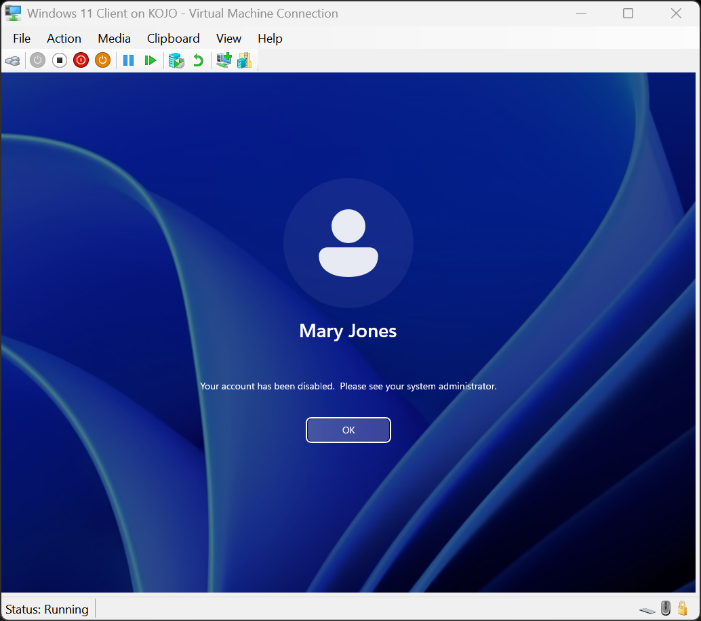
  

  <em>A disabled account at sign-in, and a password reset in Active Directory.</em>

## Help Desk Access with RSAT

I gave a Help Desk group permission to reset passwords for users in the Employees OU only. Then I installed RSAT (Remote Server Administration Tools) on the Windows 11 client so the Help Desk account could open Active Directory Users and Computers from that computer.

In a company, help desk techs don't sign in to the domain controller. They manage accounts from their own computer with RSAT, and they only get the permissions they need for their job. This is called least privilege.

  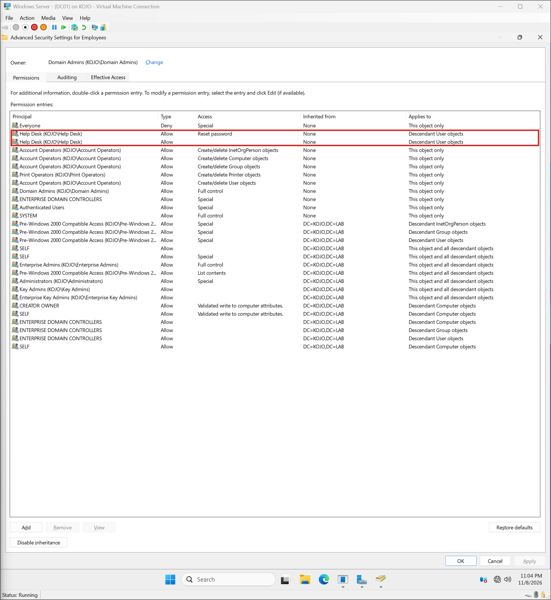

  <em>The Help Desk group's Reset password permission on the Employees OU.</em>

Signed in as the Help Desk account, I was able to reset a password for a user in Employees. Resetting a password for a user in Management was denied, and so was adding a user to the Managers group, because those permissions weren't given.

  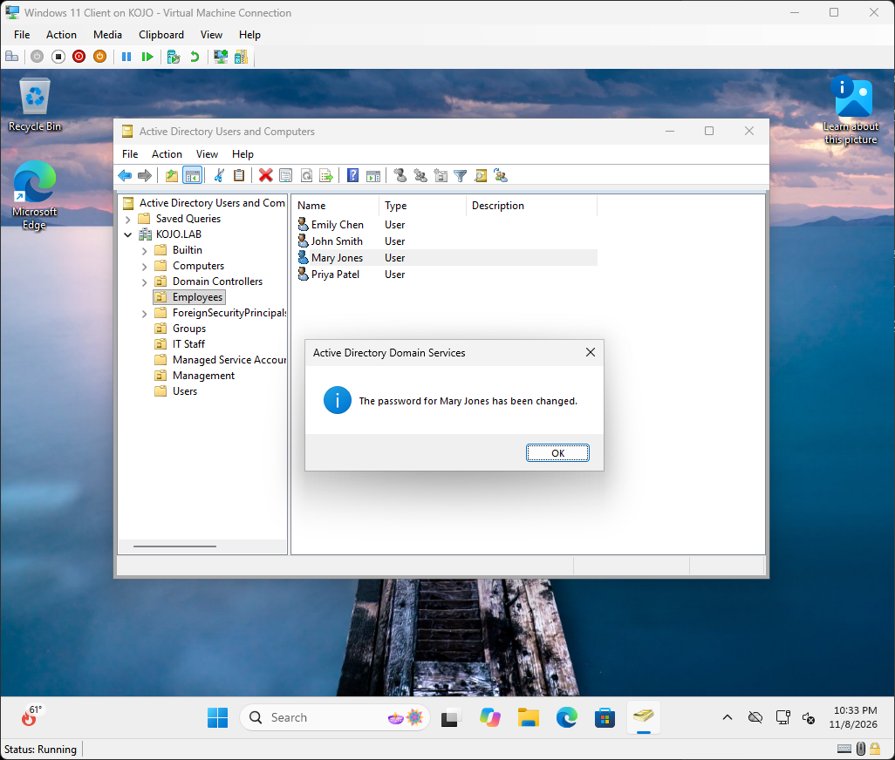
  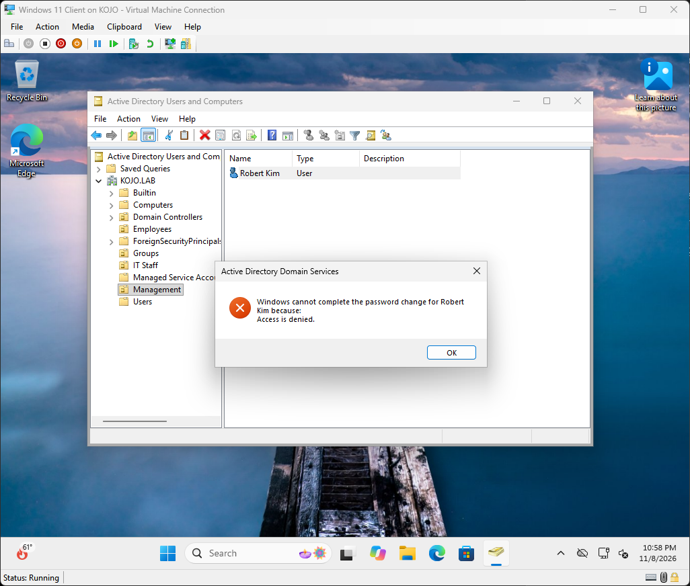

  <em>A password reset allowed in Employees and denied in Management.</em>

  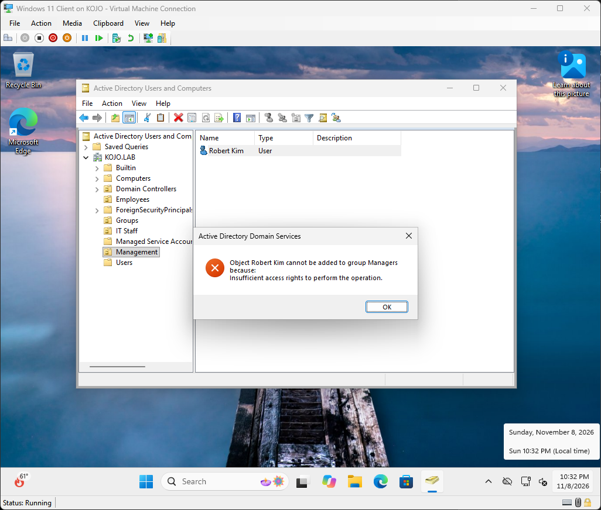

  <em>The Help Desk account denied when adding a user to the Managers group.</em>

## Group Policy

I created a Group Policy Object (GPO) that blocks Control Panel and Settings, and linked it to the Employees OU.

Companies use Group Policy to apply the same settings to many users or computers at once, like blocking certain settings, mapping drives, or setting a desktop wallpaper. A GPO applies to the OU it's linked to, so only users in Employees get this setting.

  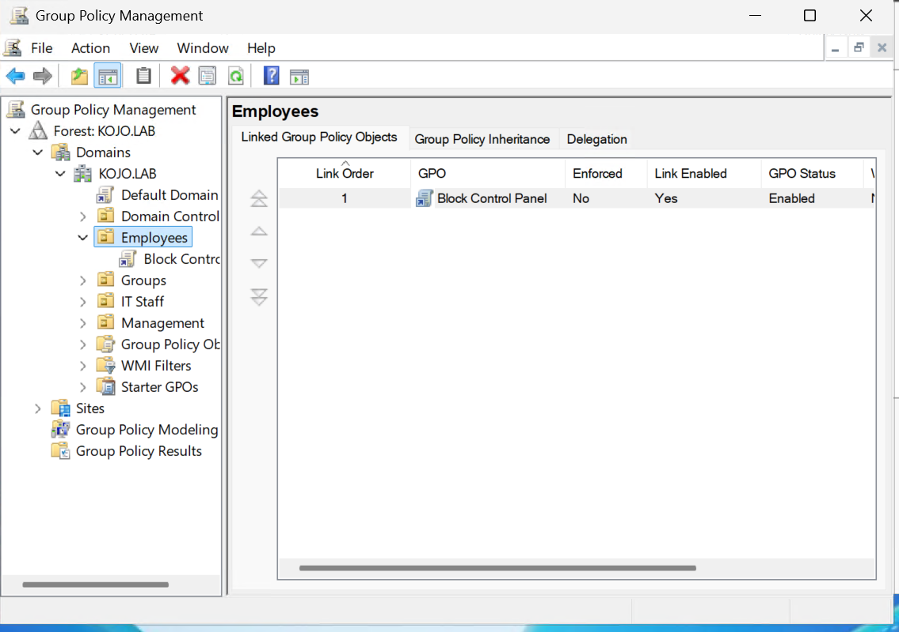
  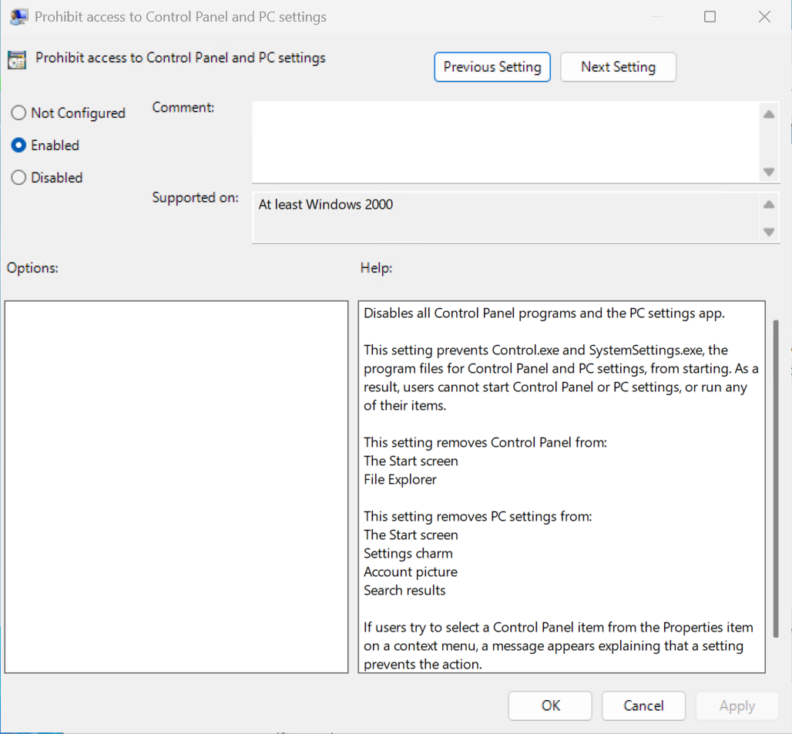

  <em>The GPO linked to the Employees OU, and the Control Panel setting enabled.</em>

I signed in as a user in Employees, ran `gpupdate /force`, and Control Panel was blocked. `gpresult /r` showed the GPO was applied. A user outside Employees could still open Control Panel and Settings.

  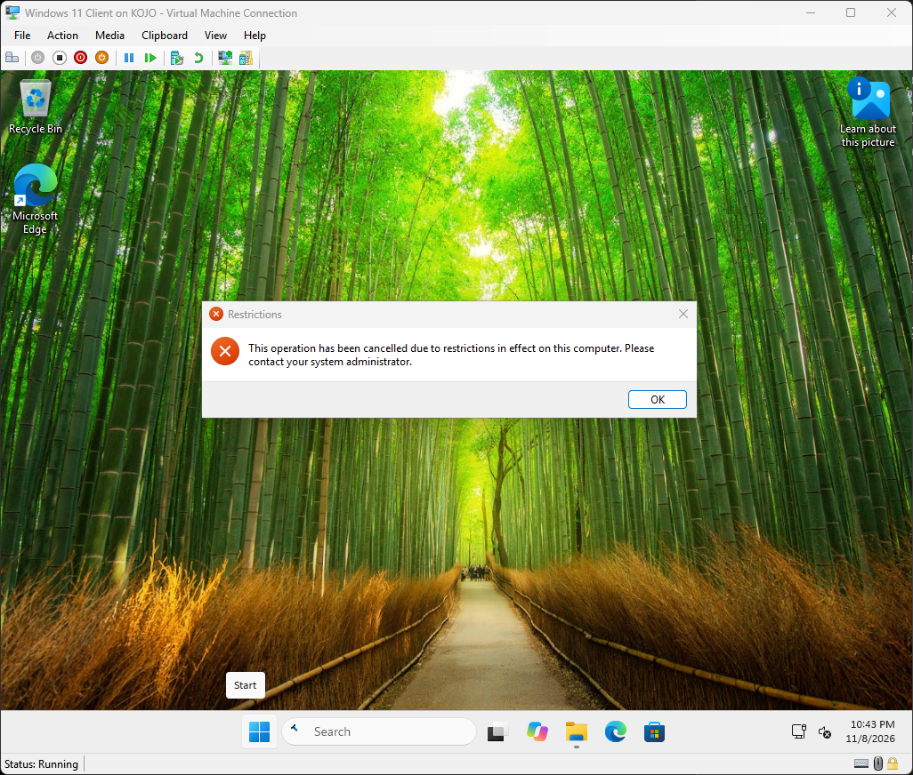
  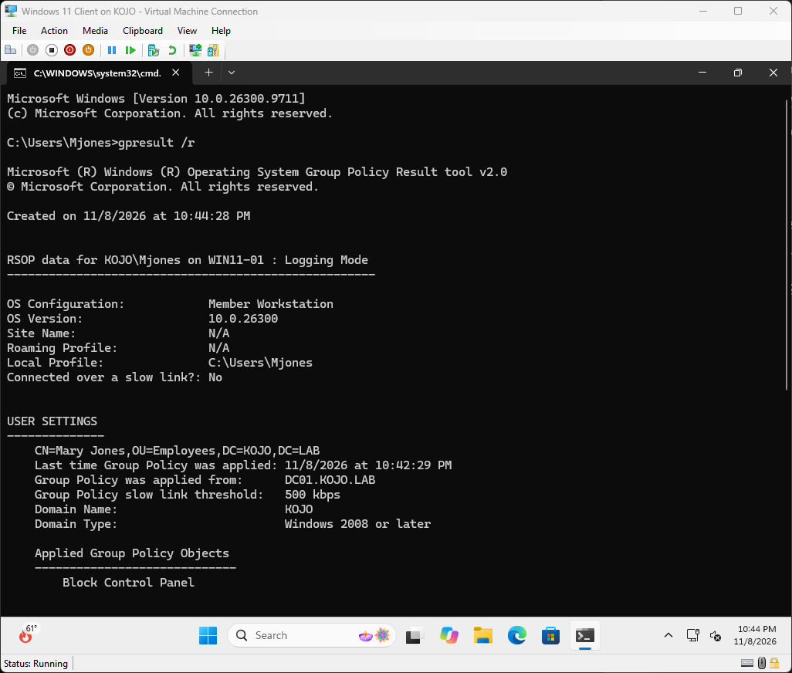

  <em>Control Panel blocked for an Employees user, and gpresult showing the GPO applied.</em>

  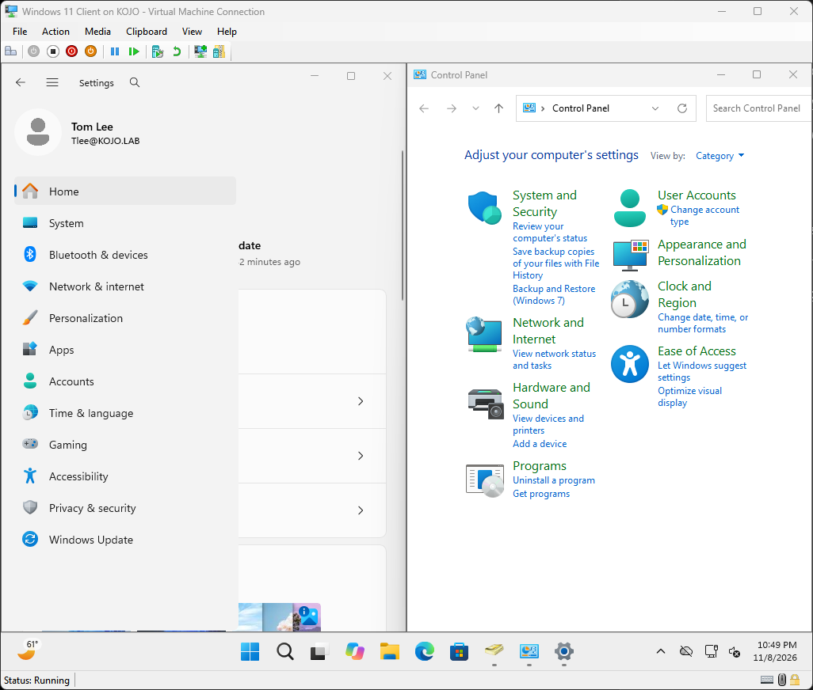

  <em>A user outside the Employees OU isn't affected.</em>

## What I Learned

- How a domain controller, DNS, and domain-joined computers work together
- Why a domain controller needs a static IP
- Why domain computers need to use the domain controller for DNS
- How OUs, users, and groups are used to organize accounts
- How least privilege works when giving the help desk only the permissions it needs
- That a GPO applies based on which OU a user is in, not which groups they're in

## Skills Practiced

- **Active Directory:** setting up a domain controller, creating a new domain, and organizing accounts with Organizational Units (OUs) and security groups
- **Account management:** creating user accounts, resetting passwords, and enabling and disabling accounts
- **Delegation and least privilege:** giving a Help Desk group password-reset rights on one OU only
- **RSAT:** managing Active Directory from a Windows 11 client instead of the server
- **Group Policy:** creating and linking a GPO to an OU, and checking it with `gpupdate` and `gpresult`
- **DNS:** how computers find each other and the domain controller by name, and forward lookup zones
- **Domain join:** connecting a Windows 11 computer to a domain and signing in with a domain account
- **Networking basics:** static IP addressing and pointing computers to the right DNS server
- **Windows Server 2025** and **Windows 11**
- **Hyper-V:** creating virtual machines and an isolated virtual network

---

[← Back to portfolio](../README.md)
