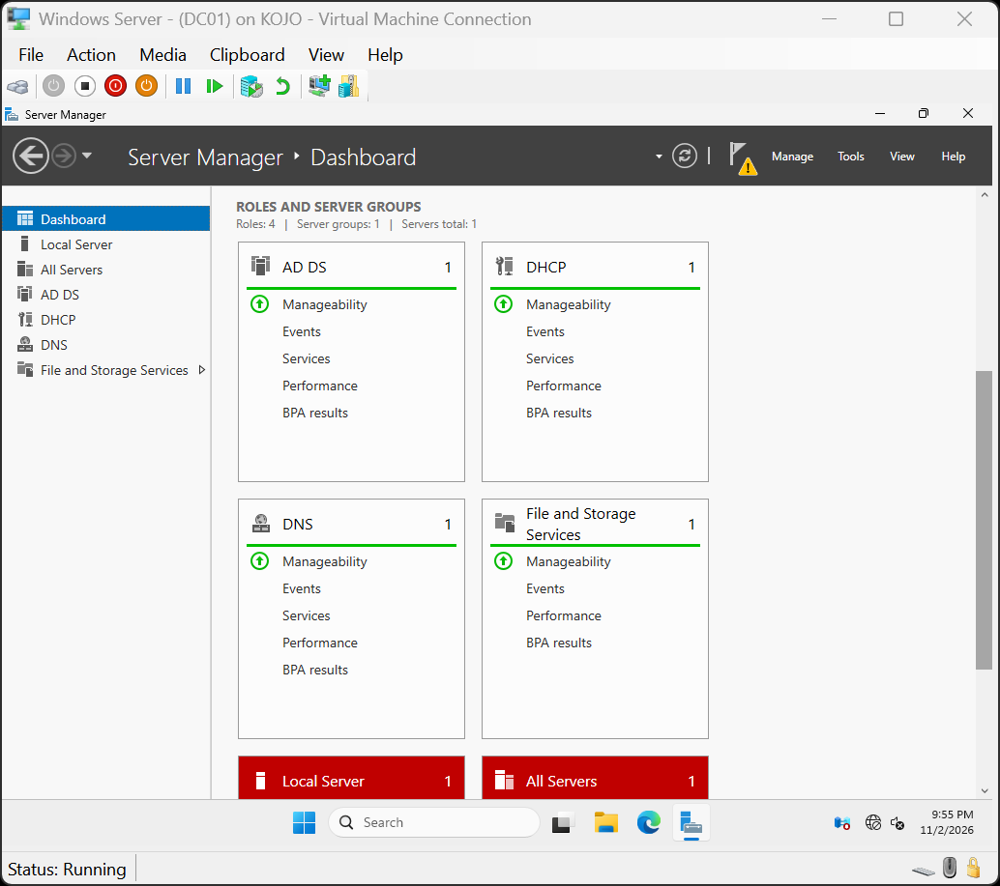
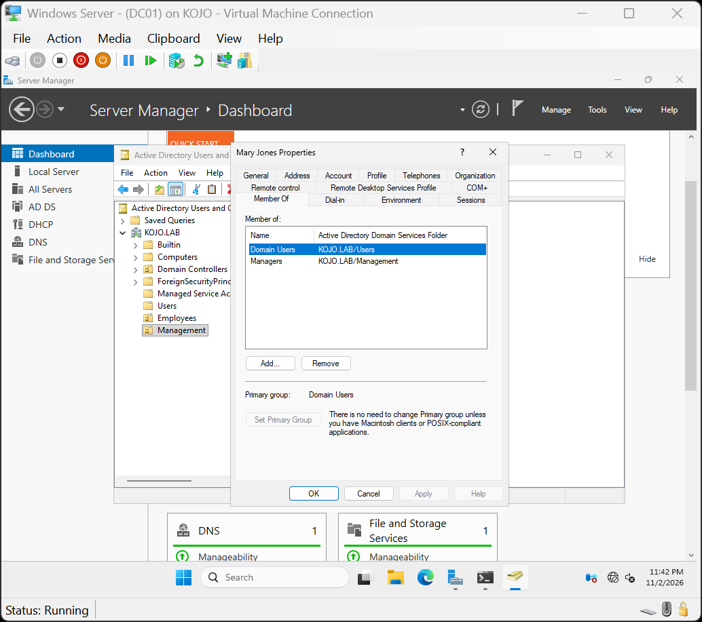
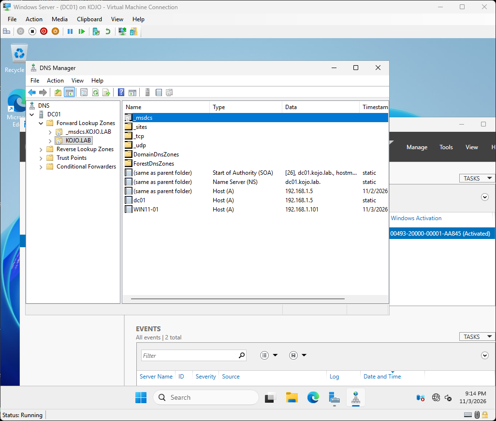
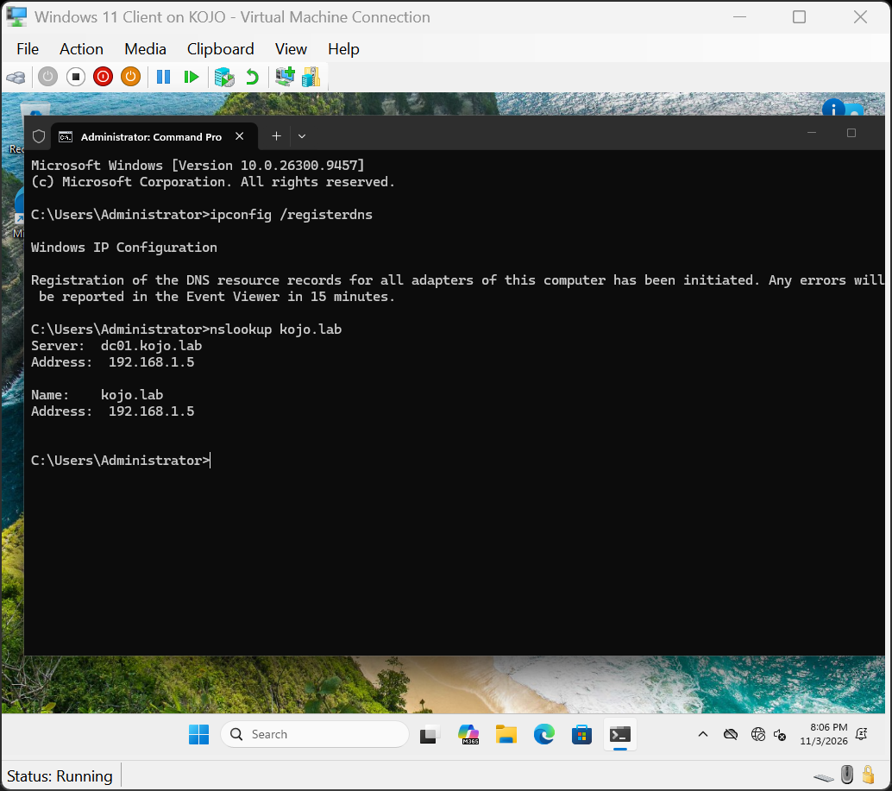
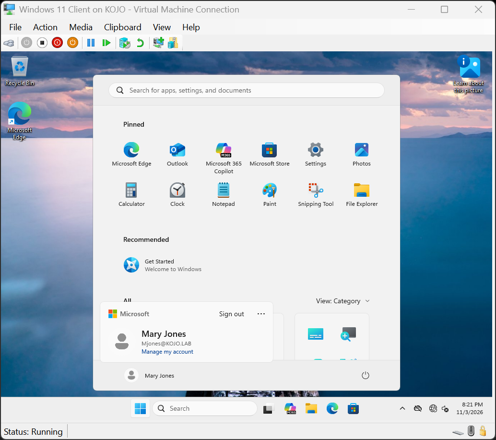
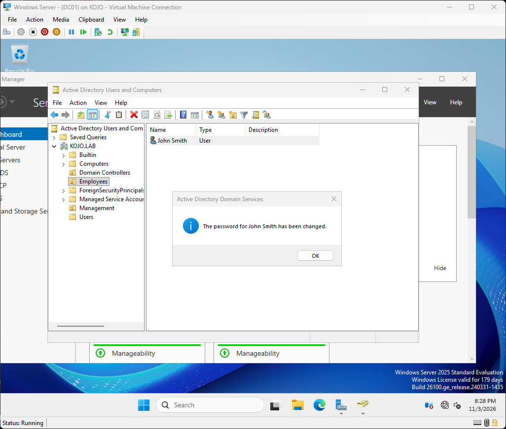
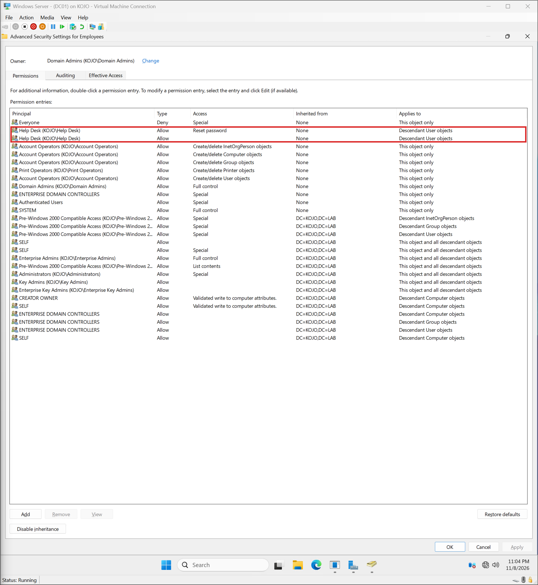

# Project 3: Active Directory & DNS Environment

This project is a small Windows domain built in Hyper-V on my own PC. Its purpose was to learn the fundamentals of Active Directory and DNS, and how organizations use them to manage users and computers.

## Lab Setup

| Component | Details |
|---|---|
| Hypervisor | Hyper-V |
| Domain Controller | `DC01` — Windows Server 2025 (192.168.1.5) |
| Client | `WIN11-01` — Windows 11 Pro (192.168.1.101) |
| Domain | `kojo.lab` |
| Network | Private virtual switch, isolated from my home network |

  

  <em>Private virtual switch used to isolate the lab from my home network.</em>

## Setting Up the Domain

I assigned the server a static IP address, installed the Active Directory Domain Services (AD DS) and DNS roles, and promoted it to a domain controller for `kojo.lab`.

In an organization, the domain controller is the central point for managing user accounts and computers. Rather than creating a separate account on every computer, IT creates one account in Active Directory that the employee can use to sign in to any computer on the domain. The domain controller authenticates each sign-in. It requires a static IP address so every computer on the network can reliably locate it.

  
  

  <em>Server roles installed, and the domain confirmed with whoami and systeminfo.</em>

## Users, Groups, and OUs

I created Organizational Units (OUs) to structure the directory, then added user accounts and security groups.

OUs function like folders. Organizations use them to group accounts, often by department, which simplifies management and allows policies to be applied to specific groups of users.

Security groups are used to control access. Instead of assigning permissions to individual users, IT assigns them to a group, such as Managers, and manages access through group membership. When someone joins or leaves a team, IT adds or removes them from the group.

  
  

  <em>OU structure and a user's group membership in Active Directory.</em>

## DNS

DNS was configured as part of the domain controller setup.

DNS resolves names to IP addresses. When a computer needs to reach `kojo.lab`, it queries DNS for the IP address and then connects to it.

For this reason, domain-joined computers must use the domain controller as their DNS server, since it holds the records for `kojo.lab`. The forward lookup zone below shows each computer's name mapped to its IP address.

  

  <em>DNS forward lookup zone for kojo.lab.</em>

## Joining a Computer to the Domain

I configured the Windows 11 VM to use the domain controller for DNS, verified name resolution with `nslookup`, joined it to `kojo.lab`, and signed in with a domain account.

Joining a computer to the domain connects it to Active Directory, allowing IT to manage it centrally and employees to sign in with their organization account instead of a local one. The computer must be able to locate the domain controller before joining, so DNS was verified first. This is a standard step when setting up a new workstation.

  
  

  <em>The client resolving kojo.lab with nslookup, and signed in as a domain user.</em>

## Basic Account Management

I performed password resets and enabled and disabled user accounts in Active Directory.

These are among the most common help desk tasks. Password resets are needed when a user forgets their password or is locked out. Accounts are disabled when an employee leaves to prevent further access, and enabled when a new employee starts.

  
  

  <em>A disabled account at sign-in, and a password reset in Active Directory.</em>

## Help Desk Access with RSAT

I delegated password-reset permissions to a Help Desk group for users in the Employees OU only, and installed RSAT (Remote Server Administration Tools) on the Windows 11 client so the Help Desk account could manage Active Directory from that computer.

In an organization, help desk technicians do not sign in to the domain controller directly. They manage accounts from their own workstation using RSAT, with only the permissions their role requires. This is the principle of least privilege.

  

  <em>The Help Desk group's Reset password permission on the Employees OU.</em>

Testing as the Help Desk account confirmed the delegation: a password reset for a user in Employees succeeded, while a reset for a user in Management was denied.

  
  

  <em>A password reset allowed in Employees and denied in Management.</em>

## Group Policy

I created a Group Policy Object (GPO) that restricts access to Control Panel and Settings, and linked it to the Employees OU.

Organizations use Group Policy to apply consistent settings across many users or computers at once, such as restricting settings, mapping drives, or setting a desktop wallpaper. A GPO applies to the OU it is linked to, so only users in Employees receive this restriction.

  
  

  <em>The GPO linked to the Employees OU, and the Control Panel setting enabled.</em>

To verify the policy, I signed in as a user in Employees and ran `gpupdate /force`. Control Panel was blocked, and `gpresult /r` confirmed the GPO was applied. A user outside the Employees OU could still open Control Panel and Settings.

  
  

  <em>Control Panel blocked for an Employees user, and gpresult showing the GPO applied.</em>

  

  <em>A user outside the Employees OU is not affected.</em>

## What I Learned

- How a domain controller, DNS, and domain-joined computers work together
- Why a domain controller needs a static IP
- Why domain computers need to use the domain controller for DNS
- How OUs, users, and groups are used to organize accounts
- How least privilege limits the help desk to only the permissions its role requires
- That a GPO applies based on a user's OU, not their group membership

## Skills Practiced

- **Active Directory:** setting up a domain controller, creating a new domain, and organizing accounts with Organizational Units (OUs) and security groups
- **Account management:** creating user accounts, resetting passwords, and enabling and disabling accounts
- **Delegation and least privilege:** giving a Help Desk group password-reset rights on one OU only
- **RSAT:** managing Active Directory from a Windows 11 client instead of the server
- **Group Policy:** creating and linking a GPO to an OU, and checking it with `gpupdate` and `gpresult`
- **DNS:** how computers find each other and the domain controller by name, and forward lookup zones
- **Domain join:** connecting a Windows 11 computer to a domain and signing in with a domain account
- **Networking basics:** static IP addressing and pointing computers to the right DNS server
- **Windows Server 2025** and **Windows 11**
- **Hyper-V:** creating virtual machines and an isolated virtual network

---

[← Back to portfolio](../README.md)
